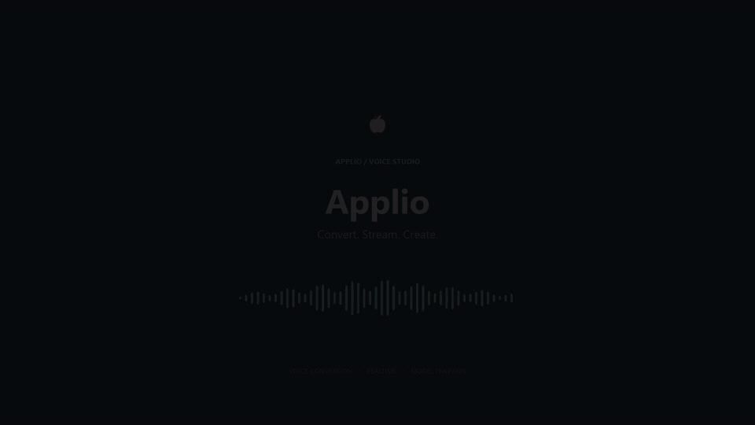

# Applio App

A desktop studio for voice conversion, realtime voice changing, speech synthesis, and model training.

[Download](https://github.com/IAHispano/Applio-app/releases) · [Documentation](https://docs.applio.org) · [Discord](https://discord.gg/wY7gmqTyEV) · [Support development](https://ko-fi.com/iahispano)

[](assets/demo.mp4?raw=true)

40-second captioned tour, without audio: [1080p video](assets/demo.mp4?raw=true) · [WebM](assets/demo.webm?raw=true) · [Preview](assets/demo-poster.png)

## Install

1. Download the Windows installer, macOS DMG for your architecture, or Linux AppImage/DEB from [Releases](https://github.com/IAHispano/Applio-app/releases).
2. Open Applio and select **Install / Repair** on the setup screen. Initial setup needs internet access to download dependencies and model weights.
3. Add a voice model in **Models**, then choose **Inference** to convert recordings or **Realtime** to use your microphone.

### Windows storage and updates

Choose a writable installation folder, such as `D:\Applio`. Packaged Windows builds keep app-owned preferences, models, logs, audio, Python, and caches inside that folder’s `data` directory. Updates replace application files and preserve `data` and any legacy `logs` folder. Uninstalling also leaves these folders for you to review and remove yourself.

When upgrading from an AppData-based version, Applio copies models, audio, and preferences into local storage without deleting the originals. Setup installs a fresh local Python environment rather than moving the old virtualenv. Explicitly selected external model folders remain in use. Shared operating-system prerequisites, such as Microsoft VC++ runtime, remain system-managed.

**Settings → Disk & Cache Storage → Logs & Models Folder** lets you choose another model/training folder. Save and restart to apply it. Applio verifies moved files before removing the originals; conflicting destination files stop the move.

macOS and Linux use their normal per-user app folders because application bundles and AppImage mounts are unsuitable for writable runtime data.

### GPU support

- **NVIDIA:** setup chooses the appropriate PyTorch CUDA runtime.
- **AMD on Windows:** setup detects the GPU architecture and installs native ROCm PyTorch and torchaudio from AMD’s repository. Availability depends on AMD’s wheels for your GPU. An incompatible optional torchvision installation no longer blocks HuBERT.
- **Apple Silicon:** training and feature extraction can select **Apple Silicon GPU (MPS)**, with CPU fallback for unsupported operators. Inference and realtime currently use CPU on macOS; the training change does not enable MPS for those paths.
- **CPU:** supported, with slower processing and training.

macOS releases are not yet notarized. If Gatekeeper blocks the app, verify that it came from the official release page before removing its quarantine:

```bash
xattr -cr /Applications/Applio.app
```

## Workflows

- **Inference:** convert one recording, or use batch mode for one model with many files, many models with one file, or many models with many files. Multi-model outputs are separated into model folders.
- **Realtime:** select a voice and audio devices, then start streaming. Settings apply while running; model or predictor changes may briefly pause audio while loading. Processing time and round-trip time help diagnose latency; device buffers also affect the delay you hear.
- **Training:** preprocess a dataset, extract features, train, and build an index. Missing default pretrained weights download before training when enabled. Disable pretrained weights explicitly to train from scratch.
- **Models and tools:** download and inspect models, blend checkpoints, synthesize speech, and separate audio. Separation installs optional dependencies when first used.
- **Tray:** view realtime status, start/stop streaming, mute the microphone, toggle monitoring, and open app folders.

Automatic realtime chunks retain speech context and processing headroom. FP16 decoding is optional and CUDA-only; its benefit depends on the hardware. Voice Focus c20/c50/c100 processes microphone audio locally and downloads assets from AWS when enabled. Settings include inline guidance.

## Development

Prerequisites: Git, Node.js 22+, pnpm 11, Python 3.12, and FFmpeg. The setup screen can create the Python environment.

```bash
git clone --recurse-submodules https://github.com/IAHispano/Applio-App.git
cd Applio-App
pnpm install
pnpm backend:init
pnpm desktop:dev
```

For browser development, use `pnpm dev` and open `http://localhost:3000`. The API listens on port 8000.

```text
frontend/web/      Interface
frontend/desktop/  Electron shell and installers
backend/api/       API, setup, and job orchestration
backend/applio/    Standalone Applio engine (Git submodule)
uvr/              Optional audio separation
tools/            Audio utilities
assets/           App resources and desktop translations
```

The engine remains a standalone repository. Commit engine changes inside `backend/applio`, then update the parent repository’s submodule pin. Development permits uncommitted engine edits; release builds require a committed, matching pin.

| Command | Purpose |
| --- | --- |
| `pnpm dev` | API and browser UI with hot reload |
| `pnpm desktop:dev` | API, UI, and Electron |
| `pnpm build:all` | Build all three packages |
| `pnpm build:win` / `build:mac` / `build:linux` | Build platform installers |
| `pnpm typecheck` | Check TypeScript |
| `pnpm reliability:check` | App regression and translation checks |
| `pnpm i18n:check` | Verify desktop translations |
| `pnpm runtime:check` | Check built API/frontend startup |
| `pnpm release:check` | Check the packaged app before release |
| `pnpm format` | Format and lint frontend/API code |
| `pnpm cli --help` | Show terminal commands |

Installers are written to `frontend/desktop/dist-installers/`. Build macOS releases on macOS and Linux releases on Linux.

## License and responsible use

Application source is licensed under [MIT](LICENSE). Dependencies and downloaded model weights retain their own licenses. Use voices and recordings with appropriate rights and permissions, and follow the [Terms of Use](TERMS_OF_USE.md). For commercial-use questions, contact [support@applio.org](mailto:support@applio.org).

Built on [Applio](https://github.com/IAHispano/Applio) and [rvc-cli](https://github.com/blaisewf/rvc-cli). Thanks to our [contributors](https://github.com/IAHispano/Applio-app/graphs/contributors).
